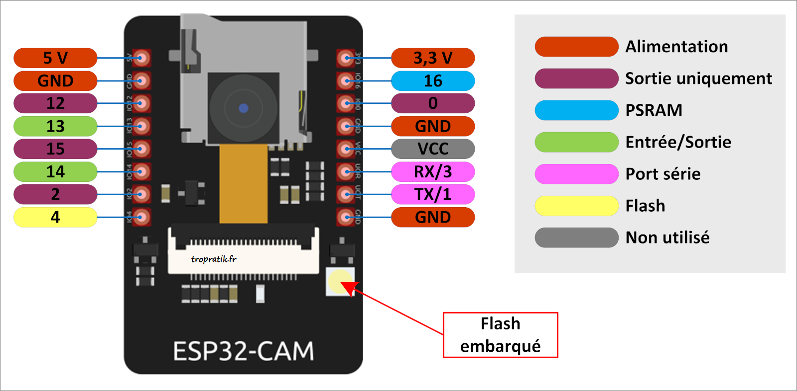

# wifi-meter

Mini détecteur de force du signal WiFi à base d'**ESP32-CAM** et d'un écran **OLED SSD1306 128×64 0,96"** (I2C).

- Connexion au réseau WiFi défini dans [include/secrets.h](include/secrets.h)
- Affichage en temps réel :
  - SSID, canal et adresse IP
  - RSSI lissé en dBm, avec un indicateur de 5 barres
  - Qualité en % (-100 dBm = 0 %, -50 dBm = 100 %)
  - Historique des ~32 dernières secondes (une mesure toutes les 250 ms)
- Le flash de l'ESP32-CAM clignote d'autant plus vite que le signal est fort (de 1,5 s à 80 ms entre deux éclairs). Il reste éteint tant que la carte n'est pas connectée.

```
+---------------------------+
|MaBox-WiFi                 |
|ch6 192.168.1.42           |
|-58 dBm           . | | | ||
|[#############    ]  84%   |
|  ~~~~\__/~~~~~~\_/~~~~~~  |
+---------------------------+
```

## Configuration

Copier [include/secrets.h.example](include/secrets.h.example) vers `include/secrets.h` et renseigner le réseau :

```c
#define WIFI_SSID "my-ssid"
#define WIFI_PASSWORD "my-password"
```

`secrets.h` est ignoré par git.

Les réglages se trouvent dans les headers :

| Fichier                                            | Réglage                                                                  |
|----------------------------------------------------|--------------------------------------------------------------------------|
| [pinout.h](include/pinout.h)                       | Broches SDA/SCL de l'écran, adresse I2C (`0x3C`), broche du flash        |
| [flash-led.h](include/flash-led.h)                 | Luminosité du flash (`FLASH_BRIGHTNESS`, 0..255), durée et périodes      |
| [signal-strength.h](include/signal-strength.h)     | Période d'échantillonnage et lissage du RSSI                             |
| [debug.h](include/debug.h)                         | Activer les traces sur le port série (`DEBUG_SERIAL`)                    |

> Le flash est très puissant : la luminosité par défaut est volontairement faible (20/255). Ne pas le pousser à 255 en continu, il chauffe et peut provoquer des resets (brownout).

## Schéma de câblage

Cf. [pinout.h](include/pinout.h).



### Écran OLED

L'écran est alimenté en **3,3 V**. GPIO 13 et 14 sont des entrées/sorties libres puisque la carte micro-SD n'est pas utilisée.

| OLED | ESP32-CAM          |
|------|--------------------|
| GND  | GND                |
| VCC  | 3,3 V              |
| SCK  | GPIO 13 (I2C SCL)  |
| SDA  | GPIO 14 (I2C SDA)  |

```
                    ESP32-CAM
                 +-------------+
    5V alim. ----| 5V     3V3  |----------------+
   GND alim. ----| GND    IO16 |                |
                 | IO12   IO0  |                |
        +--------| IO13   GND  |                |
        |        | IO15   VCC  |                |
        |   +----| IO14   U0R  |                |
        |   |    | IO2    U0T  |                |
        |   |    | IO4    GND  |-----------+    |
        |   |    +-------------+           |    |
        |   |                              |    |
        |   |        OLED 128x64           |    |
        |   |    +----------------+        |    |
        |   |    | GND            |--------+    |
        |   |    | VCC            |-------------+
        +---|----| SCK            |
            +----| SDA            |
                 +----------------+
```

Le flash (GPIO 4) est déjà câblé sur la carte : rien à ajouter.

### Alimentation

Alimenter la carte en **5 V** sur la broche `5V` (via l'adaptateur USB-série ou une alimentation capable de fournir au moins 500 mA). Le WiFi et le flash consomment des pics de courant : une alimentation trop faible provoque des redémarrages en boucle (`Brownout detector was triggered`).

## Flasher la carte

L'ESP32-CAM n'a pas de port USB : il faut soit un adaptateur USB-série (FTDI, CP2102, CH340...), soit la carte d'extension **ESP32-CAM-MB**.

### Avec la carte ESP32-CAM-MB

1. Enficher l'ESP32-CAM sur la carte MB et la brancher en USB.
2. Lancer l'upload (cf. ci-dessous). La carte MB passe automatiquement en mode programmation ; si l'upload reste bloqué sur `Connecting...`, maintenir le bouton `IO0` de la MB, appuyer brièvement sur `RST`, puis relâcher `IO0`.

### Avec un adaptateur USB-série

Régler l'adaptateur en **5 V** (ou alimenter la carte séparément en 5 V, masses communes).

| Adaptateur | ESP32-CAM |
|------------|-----------|
| 5V         | 5V        |
| GND        | GND       |
| TX         | U0R (GPIO 3) |
| RX         | U0T (GPIO 1) |
|            | **GPIO 0 relié à GND** (mode programmation) |

1. Relier GPIO 0 à GND.
2. Appuyer sur le bouton `RST` de l'ESP32-CAM (sous la carte).
3. Lancer l'upload.
4. Une fois l'upload terminé, **retirer le fil GPIO 0 – GND** et appuyer à nouveau sur `RST` pour démarrer le programme.

### Commandes PlatformIO

Depuis VS Code : icône PlatformIO > `esp32cam` > *Upload*, puis *Monitor*.

En ligne de commande :

```sh
pio run                            # compiler
pio run -t upload                  # compiler et flasher
pio run -t upload --upload-port COM6
pio device monitor                 # moniteur série (115200 bauds)
```

Le port peut aussi être fixé avec `upload_port` dans [platformio.ini](platformio.ini). Si l'upload échoue à 460 800 bauds (câbles longs, adaptateur bas de gamme), baisser `upload_speed` à `115200`.

`monitor_rts` et `monitor_dtr` sont forcés à 0 dans [platformio.ini](platformio.ini) : sinon le moniteur série maintient la carte en reset ou en mode programmation.

## Dépannage

| Symptôme                                   | Piste                                                                                 |
|--------------------------------------------|---------------------------------------------------------------------------------------|
| Écran noir                                 | Vérifier SDA/SCK, l'alimentation 3,3 V, et l'adresse I2C (`0x3C` ou `0x3D`)          |
| `SSID introuvable` à l'écran               | SSID erroné, ou réseau en 5 GHz uniquement (l'ESP32 ne gère que le 2,4 GHz)          |
| `Echec connexion`                          | Mot de passe erroné                                                                   |
| Redémarrages en boucle                     | Alimentation insuffisante, baisser `FLASH_BRIGHTNESS`                                 |
| Le programme ne démarre pas après l'upload | GPIO 0 encore relié à GND                                                             |
| Signal faible même près de la box          | Vérifier la position du cavalier d'antenne (antenne PCB / connecteur IPEX)           |
